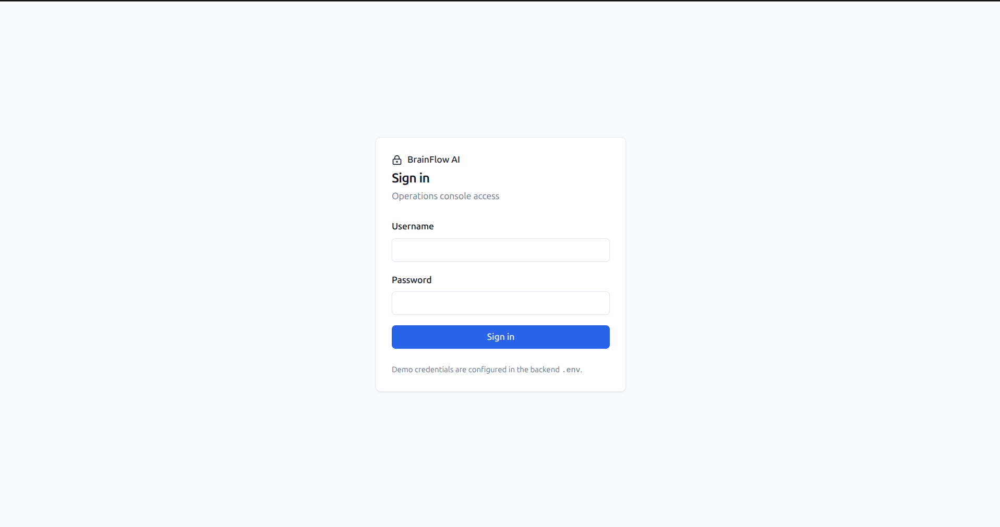
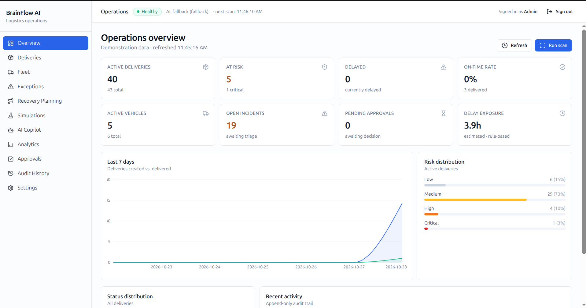
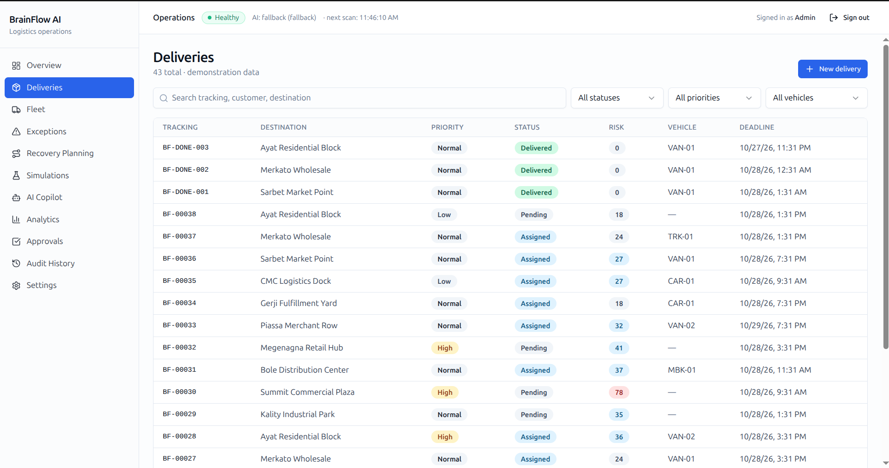
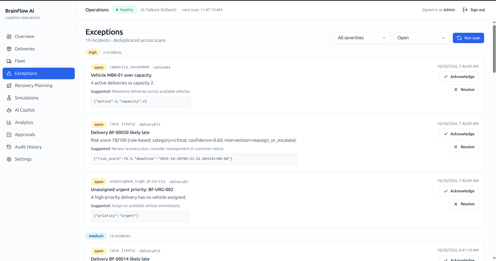
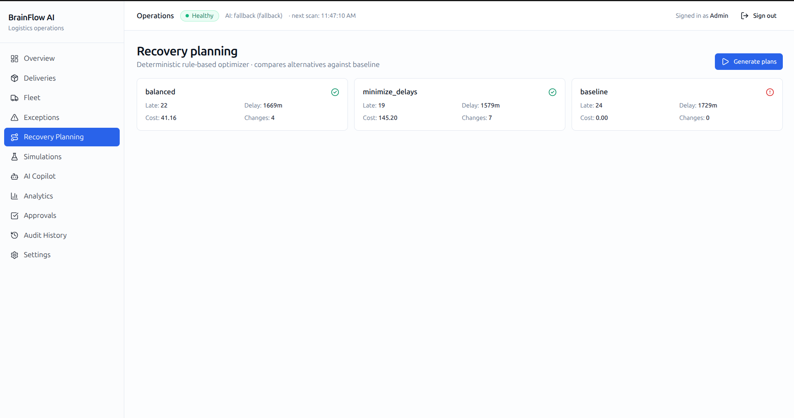
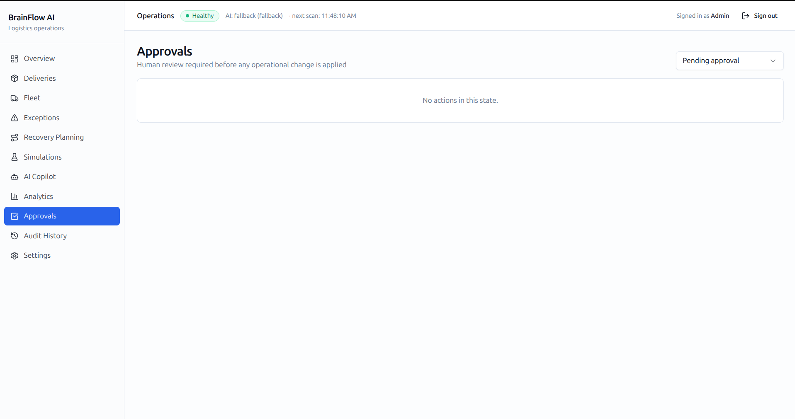
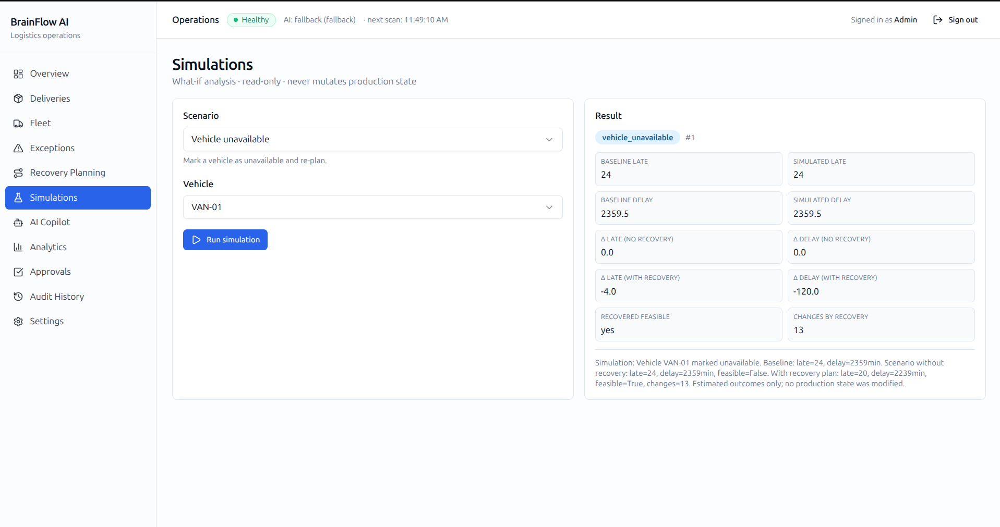
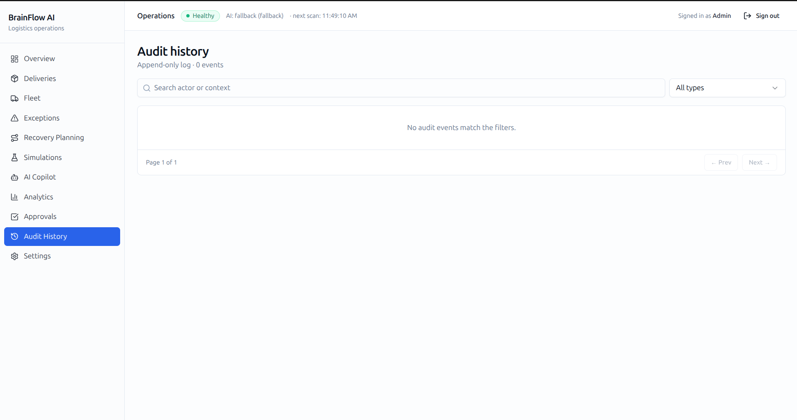

# Submission Summary — BrainFlow AI

**Kidus, this is the deliverable.** Here's everything you need to evaluate the project.

---

## 1. Problem it solves

Small and medium delivery businesses react to operational problems *after* they happen. A storm, an unavailable vehicle, or a broken-down truck leaves dispatchers reconstructing state manually and guessing at recovery.

BrainFlow AI is a **bounded operations console** that helps an operator:

1. **Monitor** deliveries and fleet
2. **Detect** disruptions via a deterministic risk engine and an exception center
3. **Analyze** with dashboards and a bounded AI copilot
4. **Optimize** recovery with a documented planner
5. **Simulate** alternatives without touching state
6. **Approve** changes through a human-in-the-loop workflow
7. **Execute** approved actions with revalidation
8. **Evaluate** outcomes with persisted analytics

The full loop works end-to-end on synthetic demonstration data.

---

## 2. Most important capabilities

| Capability | Where |
|---|---|
| Deterministic risk engine (documented formula) | `backend/app/services/risk_engine.py` |
| Exception center with stable-id dedup | `backend/app/services/incident_service.py` |
| Recovery planner with feasibility repair + objective | `backend/app/services/optimizer/` |
| Isolated what-if simulator (never mutates) | `backend/app/services/simulator.py` |
| Human approval workflow + stale-plan rejection | `backend/app/services/approval_service.py` |
| Append-only audit trail | `backend/app/services/audit_service.py` |
| Bounded AI copilot (facts from DB only) | `backend/app/services/copilot_service.py` |
| Deterministic fallbacks for LLM / weather / holidays | `backend/app/integrations/` |
| Single-admin login (bcrypt + sessions) | `backend/app/services/auth_service.py` |
| APScheduler background scans | `backend/app/services/scheduler.py` |
| 11 routed frontend pages with TanStack Query | `frontend/src/pages/` |

---

## 3. Architecture and technology choices

**Frontend** — React 19, TypeScript 5.8 strict, Vite 8, Tailwind 3, shadcn-style (Radix + CVA), TanStack Query, React Router, Recharts, React Hook Form + Zod, Sonner.

**Backend** — FastAPI, Pydantic v2, SQLAlchemy 2.1, Alembic (6 migrations), SQLite default with PostgreSQL-ready `DATABASE_URL`, APScheduler, httpx, passlib[bcrypt].

**AI** — Gemini via `google-genai` (optional). Provider abstraction returns a deterministic fallback provider when no key is set.

**External** — Open-Meteo (weather), Nager.Date (holidays), both cached and fallback-safe.

Detail: [`docs/ARCHITECTURE.md`](docs/ARCHITECTURE.md) and [`docs/TECHNICAL_DECISIONS.md`](docs/TECHNICAL_DECISIONS.md).

---

## 4. Key engineering challenges addressed

- **Determinism vs probabilistic AI** — the risk engine is pure-function; the LLM only rephrases prose. Facts come from the DB.
- **Idempotent execution** — double-click execute is safe; audit trail records a single execution event.
- **Stale-plan rejection** — before applying, the executor compares current DB state to the plan's before-snapshot; any drift → `409` with reasons.
- **Incident deduplication** — a stable identity `(kind, entity_type, entity_id, discriminator)` prevents scan spam; auto-resolve / auto-reopen.
- **Feasibility repair** — the planner fixes pre-existing infeasible state (e.g. seed's MBK-01 overflow) as part of the pipeline, not as an afterthought.
- **Simulation isolation** — snapshots are deep-copied dataclasses; tests assert no DB mutation.
- **Provider-agnostic LLM** — one protocol, two implementations; every LLM call is a bounded rephrase of pre-computed facts.

---

## 5. Tests actually executed

| Suite | Command | Result |
|---|---|---|
| Backend | `pytest -q` | **73 passed** |
| Frontend | `npm run test` | **6 files, 16 tests passed** |
| Type check | `npx tsc --noEmit -p tsconfig.app.json` | **0 errors** |
| Production build | `npm run build` | **success** (~1 MB JS, ~316 kB gzipped) |
| Lint | `npm run lint` | **0 errors, 3 informational warnings** |
| Prod deps audit | `npm audit --omit=dev` | **0 vulnerabilities** |

Full coverage table: [`docs/TESTING.md`](docs/TESTING.md).

---

## 6. How to run and demo

**Run** — see [`README.md`](README.md#installation) or copy this:

```bash
# backend
cd backend
python3 -m venv .venv && source .venv/bin/activate
pip install -r requirements.txt
cd .. && cp .env.example .env
cd backend && alembic upgrade head && python -m scripts.seed
uvicorn app.main:app --reload --port 8000 --log-config uvicorn.log_config.json

# frontend (new terminal)
cd frontend
npm install
npm run dev
```

Open http://localhost:5173. Login: admin / BrainFlow@2026.

**Demo** — [`docs/DEMO_GUIDE.md`](docs/DEMO_GUIDE.md) is a 15-minute walkthrough of the entire workflow. Short version:

1. Login
2. Run scan
3. View exceptions
4. Generate recovery plans
5. Submit one for approval
6. Approve and execute
7. Inspect audit trail
8. Run a what-if simulation
9. Ask the copilot
10. View analytics

---

## 7. Environment variables

See `.env.example`. Key:

- `ADMIN_USERNAME`, `ADMIN_DISPLAY_NAME`, `ADMIN_PASSWORD` — seeded admin
- `SCHEDULER_ENABLED`, `SCAN_INTERVAL_MINUTES` — background scans
- `DATABASE_URL` — SQLite (default) or PostgreSQL
- `GEMINI_API_KEY` — optional AI
- `CORS_ORIGINS`, `COOKIE_SECURE` — deployment
- `OPEN_METEO_BASE_URL`, `NAGER_DATE_BASE_URL` — external context

---

## 8. Limitations

Full list in [`docs/KNOWN_LIMITATIONS.md`](docs/KNOWN_LIMITATIONS.md). Summary:

- Demonstration data only. Not connected to real logistics systems.
- Rule-based risk, not trained ML. Formula is documented.
- Greedy planner, not optimal. Documented.
- Single admin, no RBAC. Adequate for the workflow; no multi-user.
- No CSRF tokens (relies on SameSite=Lax).
- APScheduler runs in-process — not for multi-instance deployment.
- Single 1 MB frontend bundle — route splitting is a follow-up.
- Playwright E2E not included — manual flow provided.

---

## Screenshots

Captured from the running application (synthetic demonstration data):

   

   

## 9. Final submission materials

    brainflow-ai/
    ├── README.md                     ← start here
    ├── SUBMISSION_SUMMARY.md         ← this file
    ├── .env.example
    ├── docs/
    │   ├── ARCHITECTURE.md           ← diagrams, formulas, data flow
    │   ├── TECHNICAL_DECISIONS.md    ← why each choice
    │   ├── TESTING.md                ← test counts, coverage
    │   ├── DEMO_GUIDE.md             ← 15-minute walkthrough
    │   └── KNOWN_LIMITATIONS.md      ← honest scope
    ├── backend/                      ← FastAPI, 73 tests
    └── frontend/                     ← Vite + React 19, 16 tests

Repository: pushed to origin/main (12+ commits, one per phase). Every step is traceable in git log.
