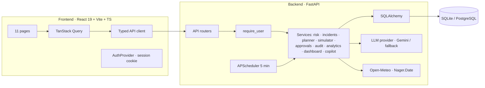

# Architecture

## System diagram



## Risk engine formula

```
score = 100 × (
    0.35 × deadline_pressure
  + 0.20 × current_delay
  + 0.15 × weather_exposure
  + 0.15 × priority_weight
  + 0.15 × (1 − data_confidence)
)

deadline_pressure = f(minutes_left / eta_minutes) ∈ [0, 1]
current_delay     = min(1, delay_minutes / 120)
priority_weight   ∈ {0.10 low, 0.30 normal, 0.65 high, 1.00 urgent}
data_confidence   ∈ [0.2, 1.0]
eta_minutes = (max(distance_km, 0.5) / 25 km/h) × 60

Categories: 0-24 low · 25-49 medium · 50-74 high · 75-100 critical
Rule-based, not trained. Deterministic.
```

## Incident detection (dedup via stable identity)

| Kind | Trigger |
|---|---|
| late_likely | risk_score ≥ 50 |
| vehicle_unavailable | assigned to unavailable vehicle |
| capacity_exceeded | active > capacity |
| severe_weather | weather_exposure ≥ 0.5 |
| unassigned_high_priority | high/urgent + no vehicle |
| missing_info | missing dispatch/deadline/distance |
| stale_estimate | not updated > 6h |

Identity = (kind, entity_type, entity_id, discriminator). Repeated scans don't duplicate; auto-resolve and reopen.

## Planner objective

```
cost(plan) =
    8.0 × late_deliveries
  + 1.0 × Σ (priority_weight × delay_minutes)
  + 0.2 × Σ delay_minutes
  + 0.5 × extra_cost
  + 2.0 × num_changes
```

Constraints: only available vehicles; capacity enforced; terminal deliveries excluded.

Algorithm: (1) baseline → (2) feasibility repair pass → (3) greedy local improvement over candidates (risk ≥ 50, urgent/unassigned, or on unavailable) → (4) return baseline / minimize_delays / balanced. Not optimal. Deterministic.

## Simulator

Snapshots to plain dataclasses; scenario applied to copy only. Returns baseline / no-recovery / recovered metrics. Never mutates DB rows (asserted by test).

## Approval lifecycle

```
DRAFT → PENDING_APPROVAL → APPROVED → EXECUTED
                      ↘ REJECTED
```

Execution: idempotency check → revalidation against before_state_json (drift → 409) → feasibility re-check → apply → audit per change → persist execution_result.

## Copilot

Deterministic routing → 4 tools. Base answer built from DB. LLM (if configured) only rephrases pre-computed facts. Fallback returns deterministic answer with explicit note.

## Reliability

- Mutations require auth
- Stale-plan rejection on execute
- Idempotent execution
- Append-only audit via service
- Deterministic fallbacks — app works without any external API
- Scan dedup
- Drafts only — never auto-send
